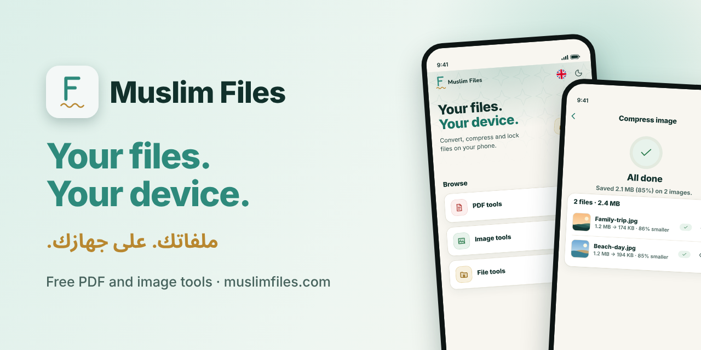
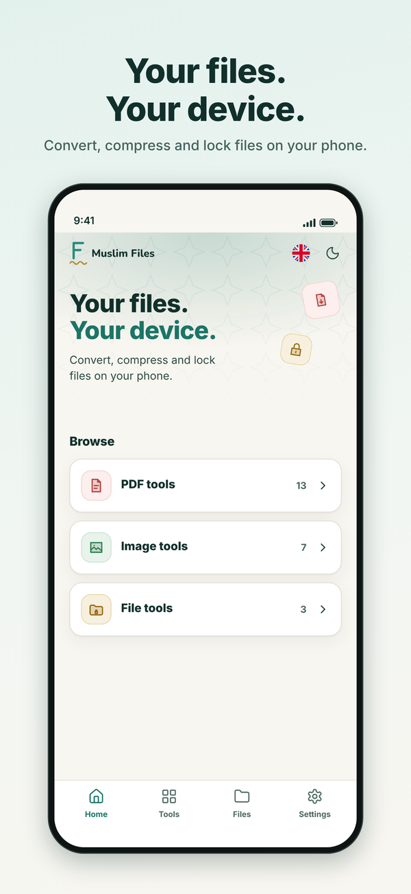
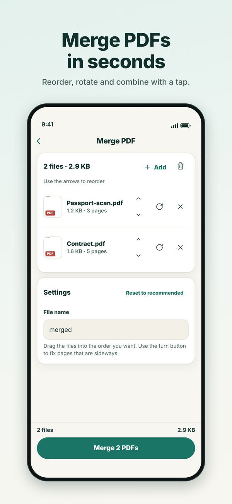
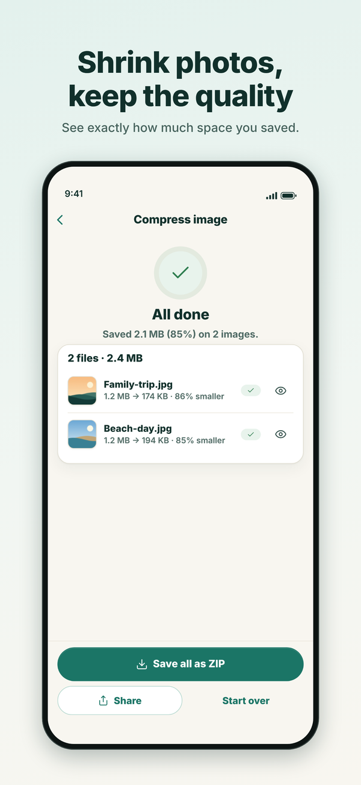
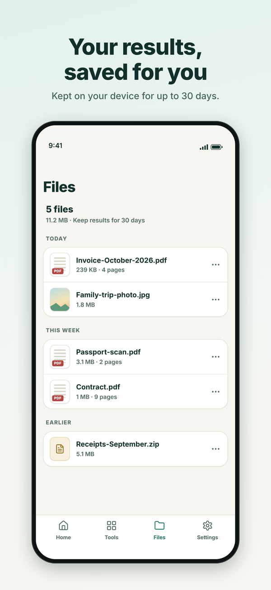
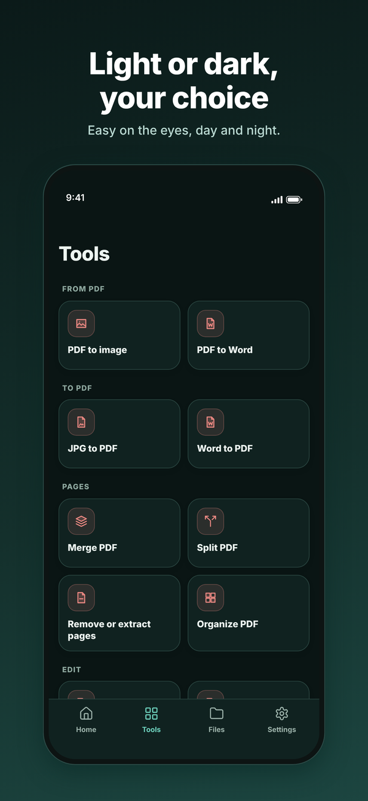

# Muslim Files

**Free PDF and image tools that run on your device.**
Merge, compress, convert and lock files, in 12 languages. Your files are never uploaded.

[**Open the website**](https://muslimfiles.com/) &nbsp;·&nbsp; [العربية](https://muslimfiles.com/ar/) &nbsp;·&nbsp; [All tools](https://muslimfiles.com/) &nbsp;·&nbsp; [Privacy](https://muslimfiles.com/privacy/)

---

## What is Muslim Files?

Muslim Files is a free toolbox for everyday PDF, image and file jobs. Open a tool, add your file, and get the result in seconds. There is no account to create and no watermark on your files.

Every tool opens and changes your file on your own device, in your browser or in the app. Your documents are not sent to a server, so private files stay private.

## Start now

| | |
|---|---|
| **Website** | [muslimfiles.com](https://muslimfiles.com/) |
| **Android app** | Coming soon on Google Play |
| **iPhone and iPad app** | Coming soon on the App Store |

## Popular tools

| Tool | What it does |
|---|---|
| [Merge PDF](https://muslimfiles.com/merge-pdf/) | Combine several PDFs into one |
| [Split PDF](https://muslimfiles.com/split-pdf/) | Pull pages out of a PDF |
| [Compress PDF](https://muslimfiles.com/compress-pdf/) | Make a PDF smaller |
| [PDF to image](https://muslimfiles.com/pdf-to-image/) | Turn PDF pages into pictures |
| [Protect PDF](https://muslimfiles.com/protect-pdf/) | Add a password to a PDF |
| [Compress image](https://muslimfiles.com/compress-image/) | Shrink photos and keep the look |
| [Remove background](https://muslimfiles.com/remove-background/) | Cut out the subject of a photo |
| [QR code generator](https://muslimfiles.com/qr-code-generator/) | Make a QR code in seconds |

There are more on the site, including Word to PDF, JPG to PDF, page numbers, watermarks, image resize and convert, and password locks for files and folders. [Browse them all](https://muslimfiles.com/).

## Why people use it

- **Private.** Files stay on your device and are not uploaded.
- **Free and simple.** No account, no watermark, no sign-up.
- **In your language.** English, Arabic, Indonesian, Turkish, French, Urdu, Malay, Bengali, Persian, German, Spanish and Russian, with right-to-left layouts where needed.
- **Made for phones.** The website works on phones, tablets and computers. The Android and iOS apps add offline use, light and dark themes and saved results that clear after 30 days.

## Screenshots

  
  
  
  
  

## Choose your language

[English](https://muslimfiles.com/) ·
[العربية](https://muslimfiles.com/ar/) ·
[Bahasa Indonesia](https://muslimfiles.com/id/) ·
[Türkçe](https://muslimfiles.com/tr/) ·
[Français](https://muslimfiles.com/fr/) ·
[اردو](https://muslimfiles.com/ur/) ·
[Bahasa Melayu](https://muslimfiles.com/ms/) ·
[বাংলা](https://muslimfiles.com/bn/) ·
[فارسی](https://muslimfiles.com/fa/) ·
[Deutsch](https://muslimfiles.com/de/) ·
[Español](https://muslimfiles.com/es/) ·
[Русский](https://muslimfiles.com/ru/)

## بالعربية

**مسلم فايلز** مجموعة مجانية من أدوات PDF والصور والملفات: ادمج وقسّم وضغّط وحوّل وأقفل ملفاتك بسهولة. كل الأدوات تعمل على جهازك أنت، فلا يتم رفع ملفاتك إلى أي خادم. لا حاجة لإنشاء حساب، والموقع متاح بـ 12 لغة.

**[افتح الموقع بالعربية](https://muslimfiles.com/ar/)**

## Project

This repository describes the Muslim Files project and links to the website. The website itself is a static site, and the mobile apps are built with Capacitor, Preact and TypeScript.

- Website: <https://muslimfiles.com/>
- Contact: <https://muslimfiles.com/contact/>
- Privacy policy: <https://muslimfiles.com/privacy/>
- Terms: <https://muslimfiles.com/terms/>

**[muslimfiles.com](https://muslimfiles.com/)**: your files, your device.

