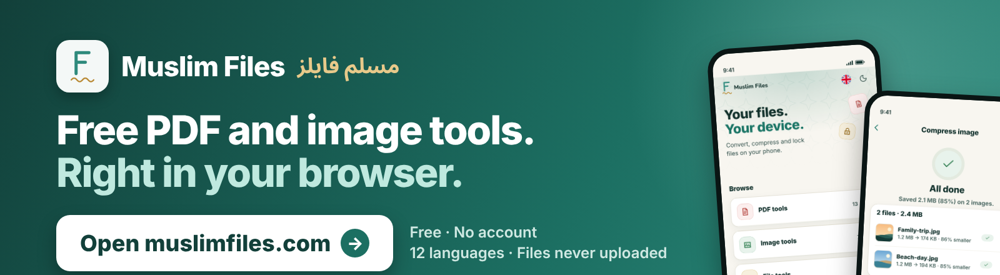

 

<h1>Muslim Files</h1>

<b>Free PDF and image tools that run on your device.</b> 
Merge, compress, convert and lock files. Nothing is uploaded.

<a href="https://muslimfiles.com/"><b>Open the website</b></a>
&nbsp;&nbsp;•&nbsp;&nbsp;
<a href="https://muslimfiles.com/ar/">العربية</a>
&nbsp;&nbsp;•&nbsp;&nbsp;
<a href="https://muslimfiles.com/privacy/">Privacy</a>

 

## Pick a tool

<table align="center">
  <tr>
    <td align="center" width="25%"> <a href="https://muslimfiles.com/merge-pdf/"><b>Merge PDF</b></a> Combine files into one  </td>
    <td align="center" width="25%"> <a href="https://muslimfiles.com/split-pdf/"><b>Split PDF</b></a> Pull pages apart  </td>
    <td align="center" width="25%"> <a href="https://muslimfiles.com/compress-pdf/"><b>Compress PDF</b></a> Make the file smaller  </td>
    <td align="center" width="25%"> <a href="https://muslimfiles.com/pdf-to-image/"><b>PDF to image</b></a> Pages as pictures  </td>
  </tr>
  <tr>
    <td align="center"> <a href="https://muslimfiles.com/protect-pdf/"><b>Protect PDF</b></a> Add a password  </td>
    <td align="center"> <a href="https://muslimfiles.com/compress-image/"><b>Compress image</b></a> Smaller photos  </td>
    <td align="center"> <a href="https://muslimfiles.com/remove-background/"><b>Remove background</b></a> Cut out the subject  </td>
    <td align="center"> <a href="https://muslimfiles.com/qr-code-generator/"><b>QR code</b></a> Make one in seconds  </td>
  </tr>
</table>

<a href="https://muslimfiles.com/">See every tool on muslimfiles.com →</a>

 

## Why Muslim Files

<table align="center">
  <tr>
    <td align="center" width="33%"><h3>Private</h3>Your files are opened and changed on your own device. They are not uploaded to a server.  </td>
    <td align="center" width="33%"><h3>Free and simple</h3>No account, no watermark. Pick a tool, add your file, get the result.  </td>
    <td align="center" width="33%"><h3>Your language</h3>Twelve languages, with right-to-left layouts for Arabic, Urdu and Persian.  </td>
  </tr>
</table>

 

## On your phone

> [!NOTE]
> The Android and iPhone apps are coming soon. They have the same tools, work offline, support light and dark themes, and clear saved results after 30 days.

  
  
  
  
  

 

## Choose your language

<a href="https://muslimfiles.com/">English</a> ·
<a href="https://muslimfiles.com/ar/">العربية</a> ·
<a href="https://muslimfiles.com/id/">Indonesia</a> ·
<a href="https://muslimfiles.com/tr/">Türkçe</a> ·
<a href="https://muslimfiles.com/fr/">Français</a> ·
<a href="https://muslimfiles.com/ur/">اردو</a> 
<a href="https://muslimfiles.com/ms/">Melayu</a> ·
<a href="https://muslimfiles.com/bn/">বাংলা</a> ·
<a href="https://muslimfiles.com/fa/">فارسی</a> ·
<a href="https://muslimfiles.com/de/">Deutsch</a> ·
<a href="https://muslimfiles.com/es/">Español</a> ·
<a href="https://muslimfiles.com/ru/">Русский</a>

 

## بالعربية

**مسلم فايلز** أدوات مجانية لملفات PDF والصور: ادمج وقسّم وضغّط وحوّل وأقفل ملفاتك. كل شيء يعمل على جهازك ولا يتم رفع ملفاتك، بدون حساب وبـ 12 لغة.

**[افتح الموقع بالعربية](https://muslimfiles.com/ar/)**

 

---

<a href="https://muslimfiles.com/"><b>muslimfiles.com</b></a>
&nbsp;•&nbsp;
<a href="https://muslimfiles.com/contact/">Contact</a>
&nbsp;•&nbsp;
<a href="https://muslimfiles.com/privacy/">Privacy</a>
&nbsp;•&nbsp;
<a href="https://muslimfiles.com/terms/">Terms</a>

